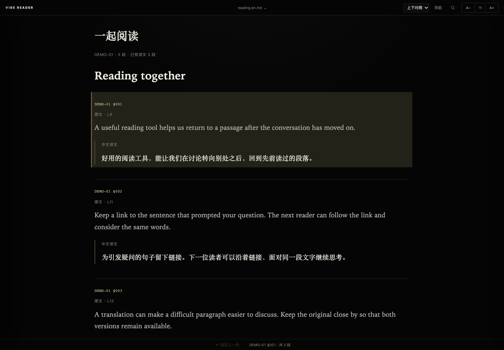

# Vibe Reader

一个本地 Markdown / 纯文本阅读器，让阅读、双语对照和 AI 讨论都能回到具体原文。

A local Markdown and plain-text reader with bilingual alignment, full-text search, and links to source lines or numbered paragraphs.



## 可以用它做什么

- **安静地读长文**：深色阅读界面、文档目录、字号调整和阅读位置记忆。
- **找到原文**：搜索全部材料，点击结果回到命中的行或段落。
- **分享具体出处**：复制选中文字、文档名及行范围链接；在不同文档之间跳转后，返回上一处。
- **原文与译文对照**：按固定段号配对，支持多段合译、缺译提示，以及只看原文或译文。
- **带着材料继续讨论**：复制当前段落及前后文，粘贴到你正在使用的 AI 对话中。

浏览器版只使用 Python 标准库，运行时无第三方依赖。界面目前以中文为主，支持阅读多种语言的文本。

## 开始使用

需要 Python 3.9 或更新版本。以下命令在 macOS 上验证；Windows 通常使用 `py` 代替 `python3`。

```bash
git clone https://github.com/alay31231/vibe-reader.git
cd vibe-reader
python3 server.py --open
```

浏览器会打开 <http://127.0.0.1:35924>。点击左上角的 **VIBE READER → 把书放进来**，或拖入 `.md`、`.markdown`、`.txt` 文件。

导入的文件保存在项目的 `library/` 中，这个目录被 Git 忽略。首次启动只读取该目录；其他材料文件夹需要明确挂载。

先用随附的原创示例试读：

```bash
python3 server.py --library examples/notes --parallel-library examples/parallel --open
```

浏览器版运行期间需要保持终端打开；在对应终端按 **Control-C** 停止服务。关闭网页标签后，服务仍会继续运行。

如果提示端口被占用，可以改用 `--port 35925`，或先停止之前的实例。

[查看搜索界面](docs/images/search.png)

## 挂载已有材料

挂载会直接读取现有文件。拖入文件会在 `library/` 中保存一份副本。

```bash
python3 server.py --library "/path/to/notes" --library "/path/to/books" --open
```

支持 Markdown 标题、段落、列表、引用、代码块、表格、链接和图片；文档内的 HTML 作为文本显示。它使用轻量的 Markdown 渲染器，复杂扩展语法可能需要调整。

## 双语对照

在同一个文件夹中放置同名的 `.en.md` 原文和 `.zh.md` 译文，通过 `--parallel-library` 挂载：

```text
my-translations/
├── reading.en.md
└── reading.zh.md
```

```bash
python3 server.py --parallel-library "/path/to/my-translations" --open
```

原文示例：

```markdown
---
doc_code: DEMO-01
language: en
---

[001] A useful reading tool helps us return to a passage.

[002] Keep the original close by.
```

译文使用相同的 `doc_code` 和段号。每段之间保留空行；合译多段时使用 `[001-002]`。文档码应在材料库中保持唯一。

`.en.md` 是原文的文件名约定，也可以存放法文等其他语言。翻译由使用者提供，阅读器负责配对和展示。

## 定位与引用

| 入口 | 示例 |
| --- | --- |
| 当前文档的源文行 | `?doc=<document-id>#L12` |
| 一段源文行范围 | `?doc=<document-id>#L12-L20` |
| 材料库中的相对文件名 | `?file=chapter.md&line=12&end=20` |
| 编号段落 | `?ref=DEMO-01%C2%A7002` |

实际使用时，点击段号或选中文字后的“复制链接”即可得到完整地址。“导航 → 段落引用”支持输入 `DEMO-01§002` 跨文档跳转。

行号会随原文件的增删移动；长期引用适合在材料中保留固定段号。文档 ID 根据绝对路径生成，移动文件后会改变。链接指向本机服务，其他人需要拥有相应材料并运行阅读器才能打开。

## 配合 AI 使用

选中原文并点击“复制引用”，或者在“导航”里选择“复制原文与上下文”，再粘贴到已有的 AI 对话中。能访问本地文件的助手也可以结合源文件行号生成阅读链接。

阅读器提供文档文本和出处，模型调用、翻译与笔记写入由外部工具承担。复制材料索引会提供文件名和阅读链接；全文访问取决于所用 AI 工具的能力与权限。

## macOS 桌面版源码

仓库也包含 Tauri 2 桌面入口，支持独立窗口、单实例、启动状态和随应用退出后台。构建说明见 [desktop/README.md](desktop/README.md)。

首发提供源码。桌面构建依赖本机 Python 和源码目录，尚未提供可直接分发的独立安装包。

## 开发与测试

```bash
python3 -m unittest discover -s tests -v
node --test tests/test_client.cjs
```

Node.js 18+ 用于运行前端测试，普通浏览器版使用不需要安装 Node.js。桌面后台测试使用 Unix 管道，适合在 macOS 或 Linux 运行。

```text
server.py       本地 HTTP 服务、文档管理和搜索
bilingual.py    按段号配对原文与译文
static/         阅读界面
examples/       原创示例材料
library/        使用者导入的文件（Git 忽略）
desktop/        macOS 桌面入口源码
tests/          Python 与 JavaScript 测试
```

## 来源与许可

阅读界面的灵感来自诗梳风播客《二十世纪的乐器》课程复盘（下）中的 Vibe Reader 演示：[节目与 show notes](https://shishufeng.com/episode/20th_century_instrument_2)。本项目围绕本地材料、双语段号、原文行号引用和桌面使用继续实现。

源码与随附示例采用 [MIT License](LICENSE)。
